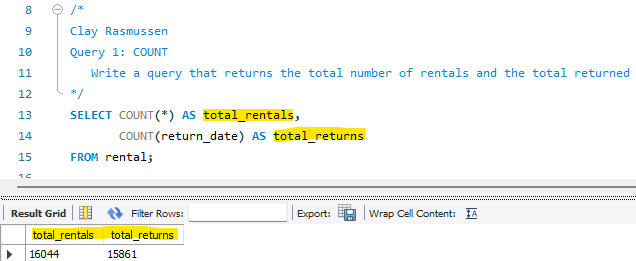

# Chapter-6---Summary-Queries

## Table of Contents

  - [Tech Stack](#tech-stack)
  - [Installation](#installation)
  - [Query 1 - Count](#query-1-count)
  - [Query 1 - Count](#query-1-count)
  - [Query 1 - Count](#query-1-count)
  - [Query 1 - Count](#query-1-count)
  - [Query 1 - Count](#query-1-count)
  - [Query 1 - Count](#query-1-count)
  - [Query 1 - Count](#query-1-count)
  - [Help](#help)
  - [Author](#author)

## Tech Stack

**Sakila Database**

[Back to the top](#table-of-contents)

## Installation

1. Clone the repository to your local machine. (Or just steal my code.)
2. Install MySQL if it is not already installed.
3. Download and install the Sakila sample database.
4. Open the project in VS Code or your preferred SQL editor.
5. Select the Sakila database before running the queries.
6. Run each query individually to verify the results.

[Back to the top](#table-of-contents)

## Query 1 - Count

### What This Exercise Was About

### New Concepts

### Learning Outcomes

**Screenshot of Output:**

[Back to the top](#table-of-contents)

---

## Help
___
If you encounter issues while completing the exercises, try the following troubleshooting steps:

- Make sure the MySQL server is running correctly.
- Confirm that the Sakila database is selected before executing queries.
- Verify that each SQL statement is written correctly and follows the required column order.
- Execute statements individually to identify where an error occurs.
- Check that records referenced by foreign keys exist before inserting related records.
- Review foreign key constraints if a deletion fails.
- Verify that the correct IDs are being used in `UPDATE` and `DELETE` statements.
- Refresh the schema window after creating or dropping tables.
- Restart your SQL editor if it stops responding.
- If necessary, re-clone the repository and confirm that all required files are present.

[Back to the top](#table-of-contents)

## Author
___

**Clay Rasmussen**
* **Clay's GitHub Profile**: [Clay-Rasmussen](https://github.com/Clay-Rasmussen)
* **Clay's Email**: [clrasm02@wsc.edu](mailto:clrasm02@wsc.edu)

**Jacob Mundt**
* **Jacobs's GitHub Profile**: [thesolejacobm](https://github.com/thesolejacobm)
* **Jacobs's Email**: [jacob.r.mundt@proton.me](mailto:jacob.r.mundt@proton.me)

[Back to the top](#table-of-contents)
