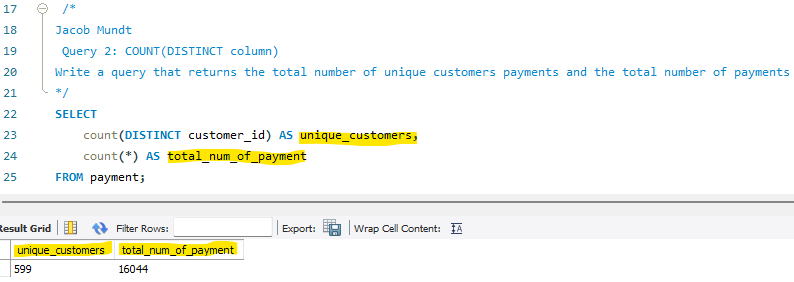
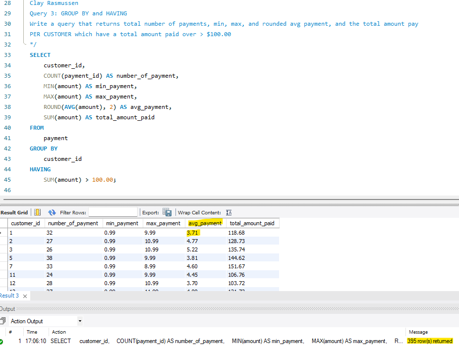
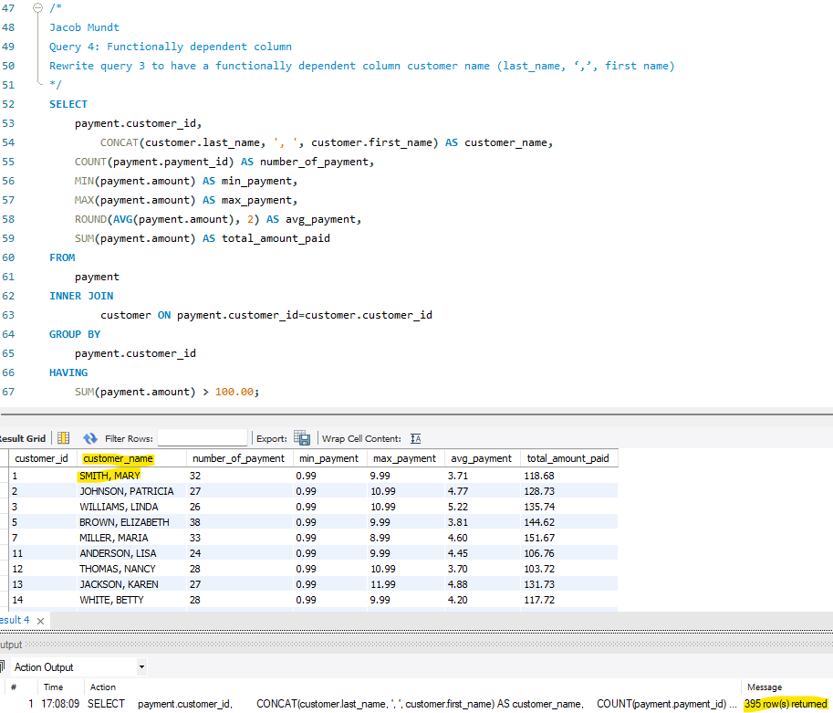
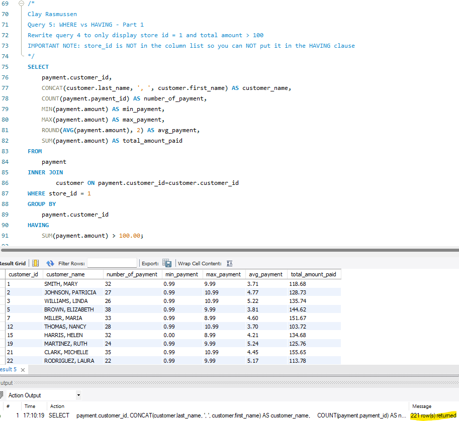
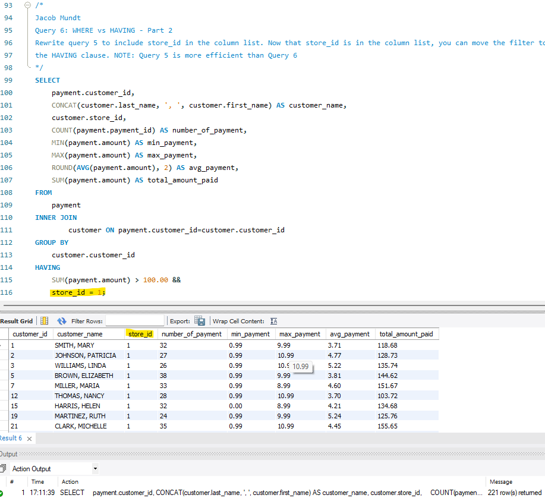
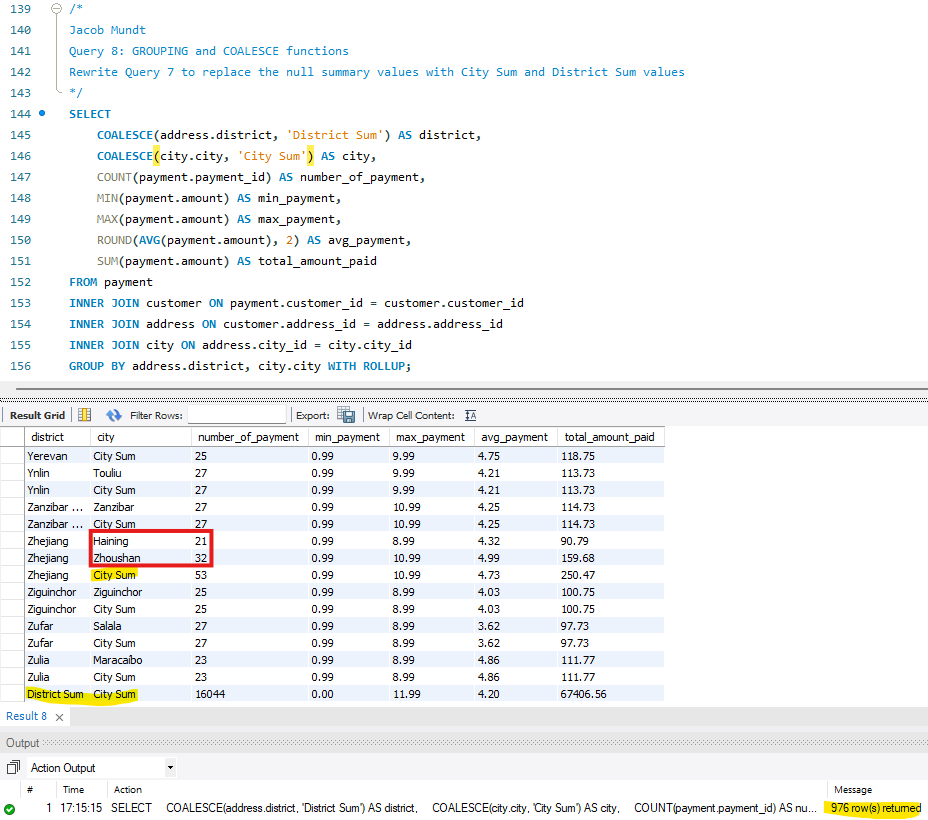

# Chapter-6---Summary-Queries

## Table of Contents

  - [Tech Stack](#tech-stack)
  - [Installation](#installation)
  - [Query 1 - Count](#query-1---count)
  - [Query 2 - Count Distinct](#query-2---count-distinct)
  - [Query 3 - Group By and Having](#query-3---group-by-and-having)
  - [Query 4 - Functionally Dependent Column](#query-4---functionally-dependent-column)
  - [Query 5 - Where vs Having Part 1](#query-5---where-vs-having-part-1)
  - [Query 6 - Where vs Having Part 2](#query-6---where-vs-having-part-2)
  - [Query 7 - With Rollup](#query-7---with-rollup)
  - [Query 8 - Grouping with Coalesce](#query-8---grouping-with-coalesce)
  - [Help](#help)
  - [Authors](#authors)

## Tech Stack

**Sakila Database**

[Back to the top](#table-of-contents)

## Installation

1. Clone the repository to your local machine. (Or just steal my code.)
2. Install MySQL if it is not already installed.
3. Download and install the Sakila sample database.
4. Open the project in VS Code or your preferred SQL editor.
5. Select the Sakila database before running the queries.
6. Run each query individually to verify the results.

[Back to the top](#table-of-contents)

## Query 1 - Count

### What This Exercise Was About
This query returned the total number of rentals and the number of rentals that had been returned. A rental with a recorded `return_date`
was counted as returned.

### New Concepts
- Using `COUNT(*)` to count all rows in a table.
- Using `COUNT(column)` to count rows where a column is not `NULL`.
- Using `return_date` to identify returned rentals.

### Learning Outcomes
- Learned how to count all records in a table.
- Practiced counting records that have a value in a particular column.
- Improved understanding of how `NULL` values affect aggregate functions.

**Screenshot of Output:**

[Back to the top](#table-of-contents)

---

## Query 2 - Count Distinct

### What This Exercise Was About

This query returned the number of unique customers who made payments and the total number of payment records. A customer with multiple payments was counted once in the unique customer total.

### New Concepts

- Using `COUNT(DISTINCT column)` to count unique values.
- Comparing a distinct-value count with a total row count.
- Counting customer payments from the `payment` table.

### Learning Outcomes

- Learned how to count unique customers in a table.
- Practiced distinguishing between the number of customers and the number of payment records.
- Improved understanding of `COUNT(DISTINCT ...)`.

**Screenshot of Output:**

[Back to the top](#table-of-contents)

---

## Query 3 - Group By and Having

### What This Exercise Was About

This query summarized each customer's payments. It returned the number of payments, minimum payment, maximum payment, rounded average payment, and total amount paid. Only customers with a total payment amount greater than $100 were included.

### New Concepts

- Using `GROUP BY` to create a summary for each customer.
- Using `COUNT`, `MIN`, `MAX`, `AVG`, and `SUM` aggregate functions.
- Using `ROUND` to display the average payment to two decimal places.
- Using `HAVING` to filter groups after aggregation.

### Learning Outcomes

- Learned how to group payment records by customer.
- Practiced calculating several aggregate values in one query.
- Learned how to filter grouped results based on a total.
- Improved understanding of the difference between filtering rows and filtering groups.

**Screenshot of Output:**

[Back to the top](#table-of-contents)

---

## Query 4 - Functionally Dependent Column

### What This Exercise Was About

This query rewrote Query 3 to include each customer's name with the payment summary. Because `customer_id` uniquely identifies a customer, the customer's first and last names are functionally dependent on that ID.

### New Concepts

- Understanding functional dependency between a primary key and other columns.
- Joining the `payment` and `customer` tables.
- Using `CONCAT` to combine a customer's last and first name.
- Grouping results by a customer ID while displaying dependent customer information.

### Learning Outcomes

- Learned how a primary key can determine the values of other columns in a row.
- Practiced joining customer information to payment records.
- Learned how to display customer names alongside grouped payment results.
- Improved understanding of functionally dependent columns in grouped queries.

**Screenshot of Output:**

[Back to the top](#table-of-contents)

---

## Query 5 - Where vs Having Part 1

### What This Exercise Was About

This query rewrote Query 4 to include customers from store 1 whose total payments were greater than $100. The store condition was applied with `WHERE`, before the records were grouped. The `store_id` column was not included in the output.

### New Concepts

- Using `WHERE` to filter individual rows before grouping.
- Using `HAVING` to filter grouped results based on an aggregate.
- Filtering customers by `store_id`.
- Applying row filters before calculating aggregates.

### Learning Outcomes

- Learned when to use `WHERE` and when to use `HAVING`.
- Practiced filtering source rows before calculating customer payment summaries.
- Learned that a regular column does not need to appear in the output to be used in `WHERE`.
- Understood why the store condition belongs in `WHERE` for this query.

**Screenshot of Output:**

[Back to the top](#table-of-contents)

---

## Query 6 - Where vs Having Part 2

### What This Exercise Was About

This query rewrote Query 5 to include `store_id` in the output. The store condition was moved to `HAVING`, where it was used with the condition on the total amount paid.

Query 5 is more efficient for this assignment because its `WHERE` condition filters rows before the database calculates the summaries.

### New Concepts

- Including a grouped column in the output.
- Using `HAVING` to filter a grouped column.
- Comparing a `WHERE` filter with a `HAVING` filter.

### Learning Outcomes

- Learned that `HAVING` can filter grouped columns and aggregate values.
- Practiced moving a filter from `WHERE` to `HAVING` when the column is included in the grouped results.
- Understood why filtering rows with `WHERE` can be more efficient.
- Improved understanding of how filter placement affects a summary query.

**Screenshot of Output:**

[Back to the top](#table-of-contents)

---

## Query 7 - With Rollup

### What This Exercise Was About

This query changed the summary level from individual customers to districts and cities. `WITH ROLLUP` added summary rows, including a grand-total row. The query did not use a `HAVING` clause to filter the data.

### New Concepts

- Joining payment, customer, address, and city information.
- Grouping payment summaries by district and city.
- Using `WITH ROLLUP` to add subtotal and grand-total rows.
- Reading rollup summary rows in the query output.

### Learning Outcomes

- Learned how to summarize data at multiple grouping levels.
- Practiced using `WITH ROLLUP` to calculate subtotals and a grand total.
- Improved understanding of how rollup rows appear in a grouped result.
- Learned that the grand-total row summarizes the full set of included payments.

**Screenshot of Output:**

[Back to the top](#table-of-contents)

---

## Query 8 - Grouping with Coalesce

### What This Exercise Was About

This query rewrote Query 7 to replace the `NULL` values in the rollup summary rows with readable labels. `COALESCE` was used to display `City Sum` and `District Sum` where the rollup results contained `NULL`.

### New Concepts

- Using `COALESCE` to replace a `NULL` value with a label.
- Using `WITH ROLLUP` to create summary rows.
- Recognizing that rollup rows use `NULL` values for summary levels.
- Using `COALESCE` to make subtotal and grand-total rows easier to read.

### Learning Outcomes

- Learned how to identify summary rows created by `WITH ROLLUP`.
- Practiced replacing rollup `NULL` values with descriptive labels.
- Improved understanding of how `COALESCE` can make grouped query output clearer.
- Learned how labels help distinguish city and district summary rows.

**Screenshot of Output:**

[Back to the top](#table-of-contents)

## Help
___
If you encounter issues while completing the exercises, try the following troubleshooting steps:

- Make sure the MySQL server is running correctly.
- Confirm that the Sakila database is selected before executing queries.
- Verify that each SQL statement is written correctly and follows the required column order.
- Execute statements individually to identify where an error occurs.
- Check that records referenced by foreign keys exist before inserting related records.
- Review foreign key constraints if a deletion fails.
- Verify that the correct IDs are being used in `UPDATE` and `DELETE` statements.
- Refresh the schema window after creating or dropping tables.
- Restart your SQL editor if it stops responding.
- If necessary, re-clone the repository and confirm that all required files are present.

[Back to the top](#table-of-contents)

## Authors
___

**Clay Rasmussen**
* **Clay's GitHub Profile**: [Clay-Rasmussen](https://github.com/Clay-Rasmussen)
* **Clay's Email**: [clrasm02@wsc.edu](mailto:clrasm02@wsc.edu)

**Jacob Mundt**
* **Jacobs's GitHub Profile**: [thesolejacobm](https://github.com/thesolejacobm)
* **Jacobs's Email**: [jacob.r.mundt@proton.me](mailto:jacob.r.mundt@proton.me)

[Back to the top](#table-of-contents)
